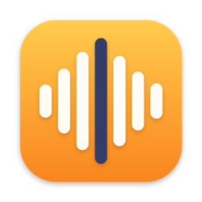

<p align="center"></p>

<h1 align="center">Infinity Flow</h1>

<p align="center">Hold a key, speak, and your words appear wherever you're typing. A native macOS dictation app built with SwiftUI.</p>

## Features

- **Hold-to-talk** with fn (Globe), Right Option, or Right Command: hold and speak, release to paste.
- **Hands-free:** double-tap the key to lock; press once more to finish and paste. A quick triple tap or Esc cancels.
- **Shortcuts:** ⌃⌘V pastes the last transcript, ⌃⌘C copies it. Sessions end at 20 minutes.
- **Floating recording pill** at the bottom of the screen with a live 10-bar waveform. It never steals focus from the app you're typing in.
- **Pastes into any app** through the clipboard and ⌘V, then restores your previous clipboard after 500 ms. Dictated text is marked so clipboard managers skip it.
- **Two engines:** on-device Apple speech recognition (private, offline, free) or the OpenAI Whisper API (key stored in your keychain).
- **History** of every dictation, grouped by date and searchable, with the app you dictated into.
- **Menu bar app** with "Paste Last Transcript", plus guided onboarding for permissions.

## Requirements

- macOS 15+, Xcode 16+
- [XcodeGen](https://github.com/yonaskolb/XcodeGen) (`brew install xcodegen`)

## Build and run

```bash
xcodegen generate
xcodebuild -project InfinityFlow.xcodeproj -scheme InfinityFlow -derivedDataPath build test
open "build/Build/Products/Debug/Infinity Flow.app"
```

On first launch, allow **Microphone**, **Speech Recognition**, and **Accessibility**. If you use fn, set
System Settings › Keyboard › "Press 🌐 key to" to "Do Nothing".

Development builds are ad-hoc signed, so macOS may ask for Accessibility again after you rebuild.

## Layout

| Path | Contents |
|---|---|
| `Sources/FlowLogic.swift` | Hold-to-talk state machine, audio-level mapping, transcript cleanup, multipart body, date groups |
| `Sources/FlowController.swift` | The dictation loop: hotkey → record → transcribe → paste → history |
| `Sources/AudioRecorder.swift` | Microphone capture to 16 kHz mono WAV with live levels |
| `Sources/HotkeyMonitor.swift` | Modifier-key monitoring for the hold-to-talk key |
| `Sources/Transcription.swift` | Apple on-device and OpenAI Whisper transcribers |
| `Sources/TextInserter.swift` | Clipboard paste into the focused app, with clipboard restore |
| `Sources/FlowPill.swift` | Floating, non-activating recording pill |
| `Sources/HubView.swift`, `SettingsView.swift` | Home, History, Settings and onboarding |
| `Tests/` | Unit tests for the logic |
| `scripts/make-icon.sh` | Regenerates the app icon from `scripts/make-icon.swift` |

Behavior is modeled on a static analysis of Wispr Flow made with [REA](https://github.com/morluto/rea); see
[docs/feature-map.md](docs/feature-map.md), where each item is marked observed, inferred, or unknown. No Wispr code or
assets are included, and Infinity Flow uses its own transcription (Apple on-device or OpenAI) rather than Wispr's service.

Infinity Flow is an independent project and is not affiliated with, endorsed by, or sponsored by the makers of Wispr Flow.
